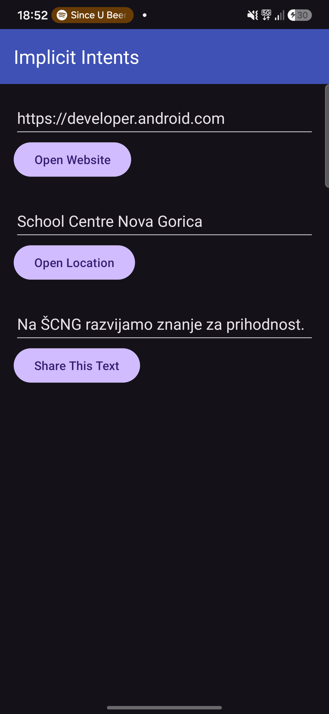
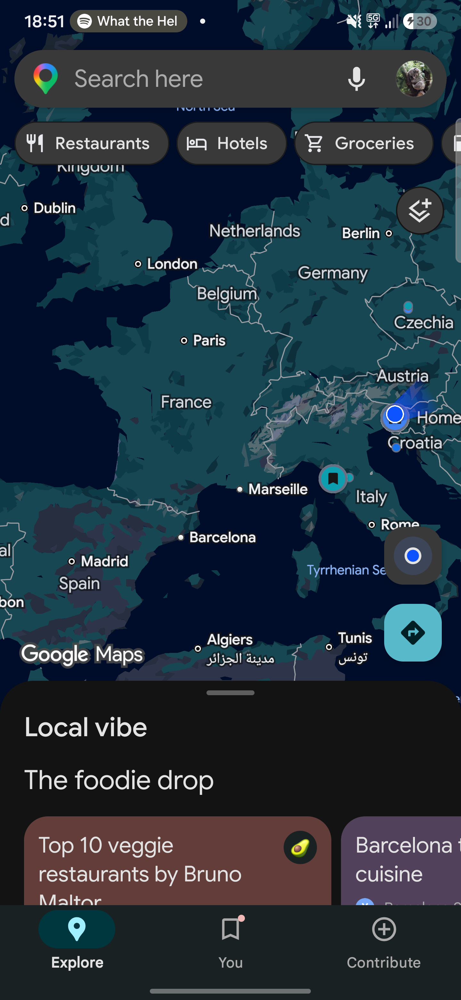
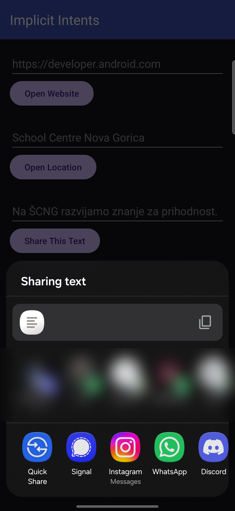

# Implicit Intents App

Simple Android app demonstrating the use of **implicit intents** to trigger external system applications (web browser, maps, and share sheet). Built as part of the Android Developer Fundamentals homework assignment.

## Overview

The application features three input fields and corresponding buttons that demonstrate different implicit intent actions:

1. **Open Website** – Opens a web page in the default browser using `Intent.ACTION_VIEW` with `http`/`https` scheme.
2. **Open Location** – Searches a location in a maps app using `Intent.ACTION_VIEW` with `geo:0,0?q=` URI.
3. **Share Text** – Shares text to other apps using `ShareCompat.IntentBuilder` with `text/plain` MIME type.

## Screenshots

| Main Screen | Open Website | Open Location | Share Text |
| :---: | :---: | :---: | :---: |
|  |  |  |  |

## Implementation Notes

- **Package Visibility (`<queries>`):** On Android 11 (API 30) and higher, `intent.resolveActivity(getPackageManager())` requires explicitly declaring intent schemes in `AndroidManifest.xml`:
  ```xml
  <queries>
      <intent>
          <action android:name="android.intent.action.VIEW" />
          <data android:scheme="https" />
      </intent>
      <intent>
          <action android:name="android.intent.action.VIEW" />
          <data android:scheme="geo" />
      </intent>
  </queries>
  ```
- **Safe Intent Execution:** Checks `resolveActivity()` before calling `startActivity()` to avoid app crashes if no app is available to handle the intent.

## Project Structure

```text
ImplicitIntentsApp/
├── app/src/main/
│   ├── java/com/domenkoder/implicitintentsapp/
│   │   └── MainActivity.java       # Activity with intent handlers
│   ├── res/
│   │   ├── layout/
│   │   │   └── activity_main.xml  # Main UI layout (vertical LinearLayout)
│   │   └── values/
│   │       └── strings.xml        # String resources
│   └── AndroidManifest.xml        # Android manifest
└── screenshots/                   # App screenshots
```

## How to Run

1. Clone or download the repository.
2. Open the project in **Android Studio**.
3. Sync Gradle and run the app on an Android device or emulator.
